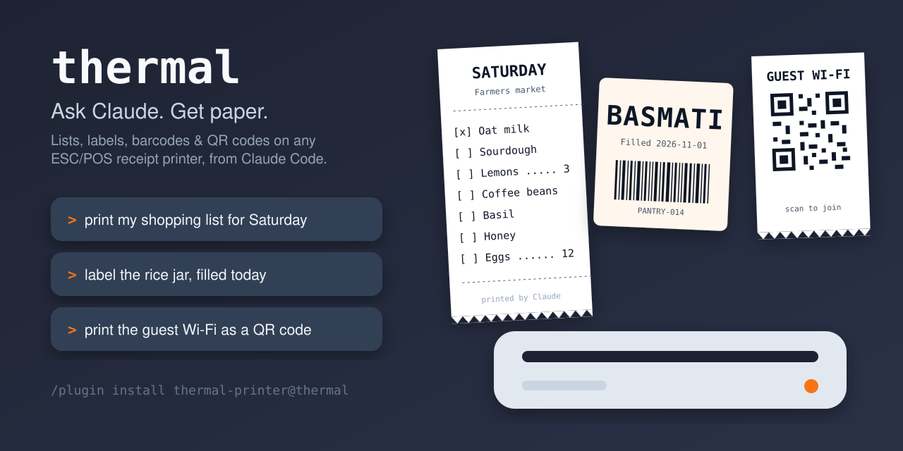
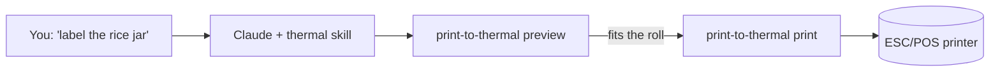

<p align="center">
  <picture>
    <source media="(prefers-color-scheme: dark)" srcset="docs/assets/logo-dark.svg">
    
  </picture>
</p>

<p align="center">
  <strong>Ask Claude for a shopping list, a jar label or a Wi-Fi QR code, and it comes out of your receipt printer.</strong>
</p>

<p align="center">
  <a href="https://github.com/matmar10/thermal/releases/latest"></a>
  <a href="https://github.com/matmar10/thermal/actions/workflows/ci.yml"></a>
  <a href="LICENSE"></a>
  
  
</p>

<p align="center">
  
</p>

---

A cheap thermal receipt printer is the fastest way to get something from your
screen onto paper: no ink, no warm-up, a sticky label in two seconds. The hard
part has always been the software. **thermal** gives Claude Code a printer: you
say what you want, Claude lays it out for your exact roll, shows you a preview,
and prints it.

## Get started in 60 seconds

In Claude Code:

```
/plugin marketplace add matmar10/thermal
/plugin install thermal-printer@thermal
```

Then say **"set up my thermal printer"**. Claude finds it on your network or
USB, picks the right model, prints a ruler to measure your paper, and remembers
which rolls you own. You do this once.

## What people print

| | Say something like… |
|---|---|
| 🛒 **Shopping & to-do lists** | "print my shopping list for Saturday", "print today's errands with checkboxes" |
| 🥕 **Grocery lists from recipes** | "make a shopping list for this recipe: https://…", "print what I need for these three dinners" — merged and sorted by store department |
| 🏷️ **Jar, bin and box labels** | "label the rice jar, filled today", "print labels for the five storage bins in the garage" |
| 📁 **Folder tabs** | "print folder tabs for 2026 taxes, medical and insurance" |
| 📅 **Your day** | "print my agenda for tomorrow" (pairs well with a calendar connector) |
| 📶 **QR codes** | "print the guest Wi-Fi as a QR code", "print a QR code for this link" |
| 🔢 **Barcodes** | "print a CODE128 barcode for PANTRY-014" |
| 📝 **Notes & tickets** | "print this as a sticky note", "print the bug title and ID so I can stick it on my monitor" |
| 🖼️ **Images** | "print this logo at full width" |

Claude composes every print from a handful of building blocks (text in four
sizes, big lettering, rules, dotted rows, barcodes, QR codes, images and cuts),
so it isn't limited to these. Anything you can describe on a strip of paper is
fair game.

## See it before it prints

Claude previews every job against the roll that's actually loaded, so nothing
wraps, overflows or gets cut off by surprise:

```text
+------------------------------------------------+  roll-80 (48 cols at 1x)
|          F a r m e r s   m a r k e t           |  2x bold
|                                                |
|                   Sat 7 Nov                    |
|------------------------------------------------|
|[ ] Oat milk                                    |
|[ ] Sourdough                                   |
|[ ] Lemons x3                                   |
|[ ] Coffee beans                                |
|[ ] Basil                                       |
+------------------------------------------------+  Partial cut, ~44mm
```

It also keeps track of which roll is loaded, so a long receipt never goes onto
your expensive sticky-label stock by accident.

## Works with the printer you already have

- **Printers:** most ESC/POS printers, including the Epson TM series and the
  many 58mm and 80mm models from Xprinter, Rongta, Munbyn, HOIN, Milestone and
  others. Star printers that only speak StarPRNT are not supported.
- **Connections:** network (`tcp://ip:9100`), USB through CUPS on macOS and
  Linux, a Windows printer queue (`win32:<printer>`), or a device such as
  `/dev/usb/lp0`.
- **Computers:** anything with Python 3.9 or newer: macOS, Linux (including
  Raspberry Pi) and Windows. Nothing else to install.

Got a printer working that isn't listed? [Open an issue](https://github.com/matmar10/thermal/issues/new)
so others know it works.

## Not using Claude Code? It's a CLI and an HTTP API too

The plugin is a thin layer over `print-to-thermal`, a small Python program
(standard library only) you can script directly or run as a service.

```sh
print-to-thermal print shopping-list --set items='["Milk","Eggs","Bread"]'
print-to-thermal serve          # HTTP API on :8631, Swagger UI at /docs
```

- **CLI:** `print-to-thermal help`. Setup is `discover`, then `setup`, then `calibrate`.
- **HTTP API:** OpenAPI 3.1 spec in [`openapi.yaml`](plugin/thermal/openapi.yaml), with
  optional token auth and an IP allowlist. Good for Home Assistant, Shortcuts,
  cron jobs or a Raspberry Pi next to the printer.
  [`docs/thermal.plist`](docs/thermal.plist) runs it as a macOS LaunchAgent.
- **Templates:** five are built in (`shopping-list`, `item-label`,
  `folder-tab`, `note`, `day`), and you can save your own as JSON.

## How it works



## Trust and privacy

- **Collects nothing.** Print jobs go only to the printer you configure. See
  the [privacy policy](PRIVACY.md).
- **Nothing downloaded, nothing compiled.** `print-to-thermal` ships inside
  the plugin as readable Python source in `plugin/thermal/`, using only the
  standard library. You can read every line that runs.
- **Your settings survive updates.** They live in `~/.config/thermal/`, not in
  the plugin.

## Contributing

Printer compatibility reports, new printer presets and templates are all
welcome. See [CONTRIBUTING.md](CONTRIBUTING.md) for building, testing and
releasing.

MIT licensed. The embedded DejaVu Sans Mono font is under its own
[license](assets/FONT-LICENSE).

## Marketing TODO

**Phase 1: foundations**
- [x] Product-led README with logo, banner and badges
- [x] Move maintainer docs to `CONTRIBUTING.md`
- [x] Social preview image (`scripts/render-social-preview.sh`, uploaded in Settings)
- [ ] Set repo description, topics and homepage (`gh repo edit`)
- [ ] Record a 15–20s demo (prompt → preview → paper) and add it under the banner
- [ ] Replace the drawn receipts with 3–4 real photos of prints

**Phase 2: social proof**
- [ ] Enable Discussions with a "Show your prints" thread
- [ ] Issue template for printer compatibility reports
- [ ] Grow the printer list into a "Known working" table
- [ ] Recipes doc: Wi-Fi card, pantry labels, morning agenda from a calendar, Home Assistant automation

**Phase 3: launch**
- [ ] Submit to Claude Code plugin directories and awesome lists
- [ ] "Show HN: I gave Claude a receipt printer"
- [ ] Posts in r/ClaudeAI, r/homeassistant, r/raspberry_pi, using the demo GIF
- [ ] Blog post on matmar10.com
