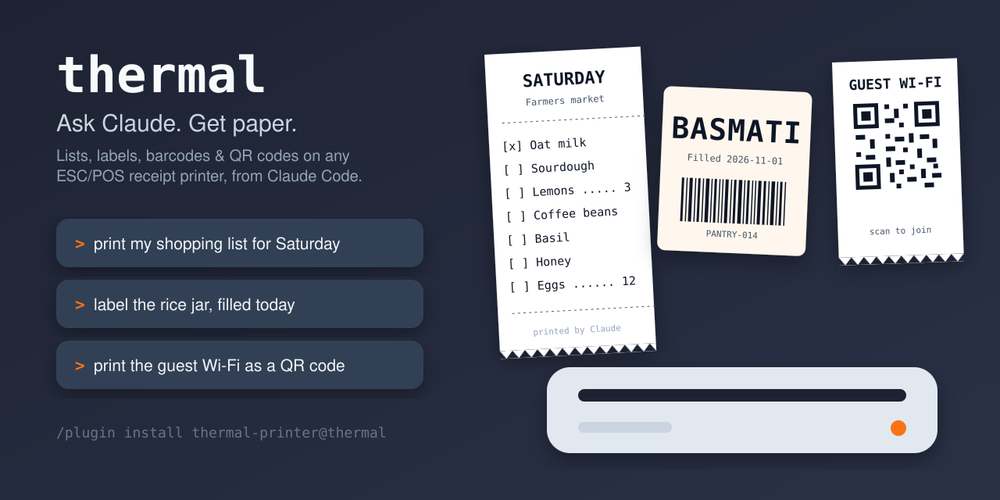

# Thermal Printer for Claude Code

**Ask Claude. Get paper.** Say "print my shopping list" or "label the rice
jar", and it comes out of your receipt printer, laid out for the roll that's
loaded and previewed before a single dot is printed.

Shopping and to-do lists, jar and bin labels, folder tabs, your day's agenda,
notes, barcodes, QR codes and images, on almost any ESC/POS thermal printer,
over the network or by USB.

Give it a recipe link, a menu or pasted recipes and say "make me a shopping
list": it merges the ingredients, sorts them by store department (produce,
butcher, dairy, canned goods…) in walking order, and prints the list.



## Install

```
/plugin marketplace add matmar10/thermal
/plugin install thermal-printer@thermal
```

Then ask Claude to "set up my thermal printer". It will:

1. find the printer: network (`tcp://ip:9100`), a USB printer in CUPS
   (`cups:<queue>`), or a Linux device (`/dev/usb/lp0`);
2. pick the closest model preset (generic 80mm and 58mm, Epson TM-T20/T88, and others);
3. print a calibration ruler, so you can tell it how wide each of your rolls
   really prints;
4. record your rolls, plain or adhesive, so it can warn before printing a
   receipt on sticker stock.

Settings live in `~/.config/thermal/printer.json` (or `$THERMAL_HOME`), and
your own templates in `~/.config/thermal/templates/`. Updating or removing
the plugin leaves them alone.

## What works

- Most ESC/POS printers: Epson TM series and the many compatible 58mm and
  80mm printers (Xprinter, Rongta, Munbyn, HOIN, Milestone and others).
  StarPRNT-only Star printers are not supported.
- macOS, Linux (including Raspberry Pi) and Windows, with Python 3.9 or newer.
  Network printers, USB printers through CUPS (macOS, Linux) or a Windows
  printer queue (`win32:<printer>`), and device paths.
- Text in four sizes, big lettering in any size, rules, two-column rows,
  barcodes, QR codes, images, multi-label strips and cuts.

## The program

`bin/print-to-thermal` (and `bin/print-to-thermal.cmd` on Windows) is a short
launcher that runs the Python package in `thermal/`. It uses only the Python
standard library, so it needs Python 3.9 or newer and nothing else: nothing is
downloaded or installed, and there are no compiled files. JPEG images need
Pillow if you have it; PNG works without it.

To pick the interpreter, set `THERMAL_PYTHON=/path/to/python3`. Source:
https://github.com/matmar10/thermal.

## Privacy

Collects nothing. Print jobs go only to the printer you configure. See the
[privacy policy](https://github.com/matmar10/thermal/blob/main/PRIVACY.md).

## License

MIT. The glyph outlines in `thermal/font.json` come from DejaVu Sans Mono,
which is under its own license; see `FONT-LICENSE`. `thermal/qrcodegen.py` is
Project Nayuki's QR Code generator (MIT).
